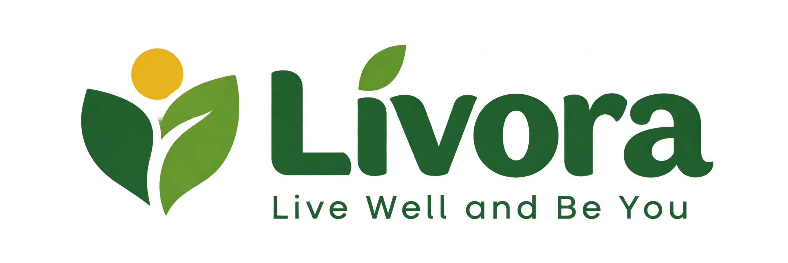

# Livora — Live Well, Be You
Website Edukasi Hidup Sehat dan Kesejahteraan (Mendukung SDG 3: Kehidupan Sehat dan Sejahtera).

---

## 👥 Anggota Kelompok (Kelompok 7)
1. **Anak Agung Ratih Hardi Maheswari** — NIM: 2515091021  
   *Tugas:Membuat halaman Beranda, dan Tentang serta Readme*
2. **I Komang Yusa Katmandu** — NIM: 2515091096  
   *Tugas: Membuat halaman artikel pada project ini*
3. **Komang Alvin Diksajaya** — NIM: 2515091045  
   *Tugas: membuat halaman Edukasi dan Readme* 
4. **I Dewa Gede Surya Palguna** — NIM: 2515091148  
   *Tugas:membuat halaman Panduan dan Repository untuk bekerjasama*

---

## 📖 Deskripsi Website
**Livora** adalah platform web edukasi interaktif yang dirancang untuk meningkatkan kesadaran generasi muda dan mahasiswa terhadap pentingnya pola hidup sehat. Website ini dikembangkan sebagai bentuk dukungan nyata terhadap **Sustainable Development Goals (SDG) Target ke-3 (Kehidupan Sehat dan Sejahtera)**. Sasaran utama pengguna website ini adalah pelajar, mahasiswa, dan masyarakat umum agar dapat menerapkan kebiasaan hidup sehat dari hal-hal kecil sehari-hari.

---

## 📄 Struktur Halaman Website
Website ini terdiri dari 5 halaman utama yang saling terhubung secara konsisten
1. **Beranda (`indeks.html`)**: Halaman utama yang memuat sambutan (*hero section*), pengenalan target SDG 3, serta ringkasan data kesehatan nasional
2. **Edukasi (`edukasi.html`)**: Pusat pengetahuan yang mengupas tiga pilar utama hidup sehat: nutrisi & pola makan, rutinitas gerak aktif, serta manajemen stres.
3. **Panduan (`panduan.html`)**: Halaman interaktif yang dilengkapi Kalkulator BMI (Body Mass Index) mandiri, panduan "Isi Piringku", serta tips aktivitas fisik dan waktu tidur
4. **Artikel (`artikel.html`)**: Rubrik wawasan khusus yang membahas statistik penting seputar kesehatan mental remaja, pentingnya berani mencari bantuan profesional, serta kiat merawat kewarasan
5. **Tentang (`tentang.html`)**: Berisi informasi profil anggota kelompok pengembang, tujuan pembuatan website untuk UTS Pemrograman Web, serta daftar referensi pustaka

---

## 💻 Teknologi yang Digunakan
* **HTML5**: Menggunakan elemen semantik seperti `<header>`, `<nav>`, `<main>`, `<section>`, `<article>`, dan `<footer>`.
* **CSS3**: Menggunakan stylesheet eksternal terpisah untuk setiap halaman dengan penerapan variabel warna (`:root`).
* **Layout & Responsivitas**: Menggunakan **Flexbox** dan **CSS Grid** untuk penyusunan tata letak kartu dan struktur halaman yang fleksibel
* **Media Queries**: Mengatur penyesuaian tampilan agar optimal pada perangkat Desktop, Tablet, dan Smartphone

---

## Penjelasan Implementasi

Website **Livora - Live Well, Be You** adalah website statis 5 halaman yang dibangun hanya dengan **HTML dan CSS**. Satu-satunya JavaScript ada di fitur Kalkulator BMI pada halaman Panduan. Tema website adalah **SDG 3: Kehidupan Sehat dan Sejahtera**, dengan palet warna dominan hijau, kuning, dan putih.

| Halaman | File | Isi utama |
|---|---|---|
| Beranda | `index.html` | Hero, penjelasan isi SDG 3, 4 kartu data (gizi, aktivitas fisik, kesehatan mental, pencegahan penyakit), fakta singkat, sumber gambar |
| Edukasi | `edukasi.html` | Tiga pilar hidup sehat: nutrisi, gerak aktif, manajemen stres dan istirahat |
| Panduan | `panduan.html` | Kalkulator BMI, Isi Piringku, tips aktivitas fisik, contoh jadwal mingguan |
| Artikel | `artikel.html` | Artikel kesehatan mental remaja dalam kartu horizontal |
| Tentang | `tentang.html` | Identitas pengembang, tujuan website, daftar referensi |

### 1. Navigasi

Navbar memakai tag `<nav>` dan sama di semua halaman. Tiap halaman menandai menu yang sedang dibuka dengan `class="active"`.

```html
<nav class="navbar"><div class="wrap">
  <a class="logo" href="index.html"></a>
  <input type="checkbox" id="menu-toggle">
  <label for="menu-toggle" class="burger">☰</label>
  <ul class="nav-menu">
    <li><a href="index.html" class="active">Beranda</a></li>
    <li><a href="edukasi.html">Edukasi</a></li>
    <li><a href="panduan.html">Panduan</a></li>
    <li><a href="artikel.html">Artikel</a></li>
    <li><a href="tentang.html">Tentang</a></li>
  </ul>
</div></nav>
```

**Fungsi:**
- Setiap `<a href="...">` memindahkan pengunjung ke halaman lain, jadi perpindahan halaman sepenuhnya memakai tautan HTML biasa.
- `class="active"` hanya dipasang pada menu halaman yang sedang dibuka, sehingga tampil sebagai tombol hijau penuh.
- Logo juga berupa tautan ke `index.html`.

**Navbar menempel di atas saat halaman di-scroll:**

```css
.navbar{position:sticky;top:0;z-index:50;background:var(--putih);border-bottom:3px solid var(--kuning)}
```
`position:sticky` dan `top:0` membuat navbar tetap terlihat, `z-index:50` menjaganya berada di atas konten lain, dan garis bawah kuning menjadi ciri khas desain.

**Efek garis kuning meluncur saat menu di-hover (CSS murni):**

```css
.nav-menu a::after{content:"";position:absolute;left:16px;right:16px;bottom:3px;height:3px;
  background:var(--kuning);transform:scaleX(0);transform-origin:left;transition:transform .3s ease}
.nav-menu a:hover::after{transform:scaleX(1)}
```
Garis dibuat dari pseudo-element `::after` yang awalnya berukuran nol (`scaleX(0)`). Saat di-hover, garis membesar dari kiri ke kanan (`scaleX(1)`). `transition` membuat gerakannya halus.

**Menu hamburger di HP tanpa JavaScript:**

```css
#menu-toggle{display:none}
.burger{display:none;font-size:26px;cursor:pointer;color:var(--hijau)}

@media (max-width:760px){
  .burger{display:block}
  .nav-menu{display:none;position:absolute;top:100%;left:0;right:0;flex-direction:column}
  #menu-toggle:checked ~ .nav-menu{display:flex}
}
```
Ini memakai trik checkbox. Checkbox `#menu-toggle` disembunyikan, sedangkan `<label for="menu-toggle">` (ikon ☰) berfungsi sebagai tombolnya. Saat label diklik, checkbox ikut tercentang, lalu selector `:checked ~ .nav-menu` menampilkan menu sebagai daftar vertikal.

### 2. Layout

Layout dibangun dengan **CSS Grid** dan **Flexbox**, dengan pembungkus `.wrap` agar isi selalu rapi di tengah.

**Pembungkus isi (`.wrap`):**
```css
.wrap{max-width:1040px;margin:auto;padding:0 20px}
```
`max-width` membatasi lebar isi, `margin:auto` menaruhnya di tengah, dan `padding` memberi jarak dari tepi layar.

**Warna terpusat dengan CSS Variables:**
```css
:root{
  --hijau:#1f7a3d; --hijau-muda:#2e9e57; --hijau-pucat:#e6f6ea;
  --kuning:#f6c928; --kuning-pucat:#fff6cf;
  --putih:#ffffff; --teks:#1d2b22; --abu:#5a6b60;
}
```
Semua warna disimpan sebagai variabel dan dipanggil dengan `var(--hijau)`. Jika warna ingin diganti, cukup ubah satu baris di `:root`.

**Navbar dengan Flexbox:**
```css
.navbar .wrap{display:flex;align-items:center;justify-content:space-between}
```
Logo berada di kiri, menu di kanan, keduanya sejajar secara vertikal.

**Hero dua kolom dengan Grid (Beranda):**
```css
.hero-grid{display:grid;grid-template-columns:1.1fr .9fr;gap:30px;align-items:center}
```
Teks berada di kolom kiri (sedikit lebih lebar) dan gambar bulat di kolom kanan. `fr` adalah pembagian ruang secara proporsional.

**Kotak teks hero dengan efek kaca:**
```css
.hero{background:url("../image/beranda/background.beranda.png") center/cover no-repeat;padding:56px 0}
.hero-teks{background:rgba(255,255,255,.82);padding:28px;border-radius:20px;
  backdrop-filter:blur(6px);box-shadow:0 6px 24px rgba(31,122,61,.15)}
```
Gambar latar dipasang dengan `cover` agar memenuhi area. Kotak putih semi-transparan dengan `backdrop-filter:blur` membuat teks tetap terbaca di atas gambar.

**Gambar hero berbentuk lingkaran:**
```css
.hero-img{width:100%;max-width:380px;aspect-ratio:1/1;margin:auto;border-radius:50%;overflow:hidden}
.hero-img img{width:100%;height:100%;object-fit:cover;transform:scale(1.25)}
```
`aspect-ratio:1/1` membuat kotak persegi, `border-radius:50%` mengubahnya menjadi lingkaran, dan `overflow:hidden` memotong sisa gambar. `object-fit:cover` menjaga gambar tidak gepeng.

**Gambar latar dengan lapisan warna (Fakta Singkat dan Banner Tentang):**
```css
.fakta{background:linear-gradient(rgba(20,90,45,.72),rgba(20,90,45,.72)),
  url("../image/beranda/bg.beranda.2.png") center/cover no-repeat;color:#fff}
```
Dua lapisan background digabung, yaitu lapisan hijau transparan di atas dan gambar di bawah, sehingga tulisan putih tetap jelas.

**Layout artikel selang-seling (zig-zag):**
```css
.kartu-horizontal{display:grid;grid-template-columns:280px 1fr;align-items:center}
.kartu-horizontal.dibalik{grid-template-columns:1fr 280px}
.kartu-horizontal.dibalik .gambar-samping{order:2}
.kartu-horizontal.dibalik .teks-samping{order:1}
```
Kartu bernomor ganjil menaruh gambar di kiri, sedangkan kartu dengan class `dibalik` menaruhnya di kanan dengan memanfaatkan properti `order`.

**Tabel yang bisa digeser pada layar kecil (Panduan):**
```css
.tabel-wrap{overflow-x:auto}
table{width:100%;border-collapse:collapse;min-width:460px}
```
Tabel dibungkus `.tabel-wrap`. Di layar sempit, hanya tabelnya yang bisa digeser ke samping, bukan seluruh halaman.

**Kalkulator BMI (satu-satunya JavaScript, di `panduan.html`):**
```javascript
document.getElementById('btn-hitung').addEventListener('click', function () {
  var berat = parseFloat(document.getElementById('berat').value);
  var tinggi = parseFloat(document.getElementById('tinggi').value) / 100;
  var bmi = berat / (tinggi * tinggi);
  // kategori: <18,5 Kurus | <23 Normal | <25 Berat badan lebih | selain itu Obesitas
});
```
Saat tombol "Hitung" diklik, berat dan tinggi dibaca dari input, tinggi diubah dari cm ke meter, lalu dihitung dengan rumus BMI = berat / tinggi². Hasilnya ditampilkan beserta kategori klasifikasi Asia-Pasifik, dan ada validasi jika input kosong.

### 3. Responsive Design

Website dirancang agar nyaman dibuka di laptop, tablet, dan HP.

**a. Viewport.** Semua halaman memuat tag berikut, agar HP tidak menampilkan versi desktop yang diperkecil:
```html
<meta name="viewport" content="width=device-width, initial-scale=1">
```

**b. Grid otomatis (tanpa media query).**
```css
.grid{display:grid;grid-template-columns:repeat(auto-fit,minmax(210px,1fr));gap:18px}
.target-grid{display:grid;grid-template-columns:repeat(auto-fit,minmax(290px,1fr));gap:16px}
.dua-kolom{display:grid;grid-template-columns:repeat(auto-fit,minmax(300px,1fr));gap:20px}
```
`auto-fit` dan `minmax()` membuat kartu menyesuaikan jumlah kolom sendiri: 4 kolom di laptop, 2 di tablet, dan 1 di HP.

**c. Ukuran huruf fleksibel.**
```css
.hero h1{font-size:clamp(28px,5vw,44px)}
```
`clamp(minimum, ideal, maksimum)` membuat judul membesar dan mengecil sesuai lebar layar, tetapi tidak pernah di luar batas 28px sampai 44px.

**d. Media query untuk layar kecil.**

| Breakpoint | Halaman | Perubahan |
|---|---|---|
| `max-width: 760px` | Beranda, Tentang | Menu jadi hamburger, hero 2 kolom menjadi 1 kolom, gambar bulat dikecilkan |
| `max-width: 768px` | Edukasi, Artikel, Panduan | Menu jadi hamburger, padding dan tinggi gambar dikurangi |
| `max-width: 900px` | Panduan | Grid 2 kolom menjadi 1 kolom |
| `max-width: 600px` | Panduan | Padding kartu dan ukuran judul dikecilkan |

Contoh pada Beranda:
```css
@media (max-width:760px){
  .hero-grid{grid-template-columns:1fr}
  .hero-img{max-width:280px}
}
```

**e. Gambar tidak pernah melebihi kotaknya.**
```css
img{max-width:100%;height:auto}
```

### 4. Elemen HTML dan CSS Penting Lainnya

| Bagian | Fungsi |
|---|---|
| `<header>`, `<nav>`, `<main>`, `<section>`, `<article>`, `<footer>` | Struktur semantik halaman agar mudah dibaca mesin pencari dan pembaca layar |
| `alt="..."` pada setiap `` | Teks pengganti jika gambar gagal dimuat, sekaligus aksesibilitas |
| `target="_blank" rel="noopener"` | Tautan sumber terbuka di tab baru dengan aman |
| `.kartu:hover{transform:translateY(-5px)}` | Kartu terangkat saat kursor di atasnya |
| `transition` | Membuat perubahan hover berjalan halus |
| `<ol>` dan `<li>` | Daftar anggota kelompok dan daftar referensi yang bernomor |
| `font-family:'Poppins',system-ui,sans-serif` | Font utama Poppins dengan font cadangan jika gagal dimuat |

## Struktur Folder

```
UTS-PEMWEB/
├── index.html              # Halaman 1: Beranda
├── edukasi.html            # Halaman 2: Edukasi
├── panduan.html            # Halaman 3: Panduan / Tips (berisi kalkulator BMI)
├── artikel.html            # Halaman 4: Artikel
├── tentang.html            # Halaman 5: Tentang / Referensi
├── README.md               # Dokumentasi proyek
│
├── css/                    # Satu file CSS untuk tiap halaman
│   ├── index.css
│   ├── edukasi.css
│   ├── panduan.css
│   ├── artikel.css
│   └── tentang.css
│
└── image/                  # Seluruh aset gambar
    ├── beranda/            # Gambar halaman Beranda
    │   ├── logo.livora.png
    │   ├── background.beranda.png
    │   ├── gambar.bulat.png
    │   ├── bg.beranda.2.png
    │   ├── makanan.bergizi.png
    │   ├── aktivitas.fisik.jpg
    │   ├── kesehatan.mental.png
    │   └── pencegahan.penyakit.png
    ├── tentang/            # Gambar halaman Tentang
    │   ├── logo.livora.png
    │   ├── bg.tentang.png
    │   ├── profil.pengembang.png
    │   └── latbel.tentang.png
    └── ...                 # Gambar halaman Edukasi, Panduan, dan Artikel
                            # (logo.livora.png, makanan.jpg, lari.jpg, tidur.jpg, lataredukasi.jpg,
                            #  panduanbg.jpeg, isipiring.jpg, meditasi.png, aktifitas.fisik.png, tidur.png)
```

**Penjelasan:**
- **File HTML** berada di folder utama, satu file untuk setiap halaman, sehingga alamat tautan antarhalaman cukup ditulis `nama-halaman.html`.
- **Folder `css/`** berisi satu file CSS per halaman. Setiap file memuat variabel warna, gaya navbar, gaya footer, dan gaya khusus halamannya.
- **Folder `image/`** menyimpan semua gambar. Gambar Beranda dan Tentang dirapikan ke subfolder masing-masing.
- **Alamat file berbeda di HTML dan CSS.** Di HTML alamat gambar ditulis `image/...`, sedangkan di CSS memakai `../image/...` karena file CSS berada di dalam folder `css/` dan harus naik satu tingkat dahulu.

## Website dan Repository URL

| | URL |
|---|---|
| **GitHub Pages (website)** | https://dwsuryafierce-hue.github.io/UTS-PEMWEB/ |
| **Repository GitHub** | https://github.com/dwsuryafierce-hue/UTS-PEMWEB |

## Referensi

### Sumber Informasi
1. Kementerian Kesehatan RI: Pedoman Gizi Seimbang dan Program PHBS.
2. World Health Organization (WHO): Global Guidelines on Physical Activity, Mental Health, dan Target SDG 3.
3. Pusat Data dan Informasi Kemenkes RI.
4. Kemenkes RI, Badan Kebijakan Pembangunan Kesehatan: Survei Kesehatan Indonesia (SKI) 2023.
5. Indonesia National Adolescent Mental Health Survey (I-NAMHS) 2022.
6. Perserikatan Bangsa-Bangsa (PBB): Sustainable Development Goal 3 (https://sdgs.un.org/goals/goal3).
7. World Health Organization. (2020). *WHO Guidelines on Physical Activity and Sedentary Behaviour*. https://www.who.int/publications/i/item/9789240015128
8. World Health Organization: Healthy Diet (Fact Sheet). https://www.who.int/news-room/fact-sheets/detail/healthy-diet

### Artikel Pendukung
- Antara News: Meditasi untuk Hidup Lebih Tenang, Manfaat dan Cara Praktiknya. https://www.antaranews.com/berita/5286007/meditasi-untuk-hidup-lebih-tenang-manfaat-dan-cara-praktiknya
- Alodokter: Ini Alasan Mengapa Olahraga Bisa Tingkatkan Suasana Hati. https://www.alodokter.com/ini-alasan-mengapa-olahraga-bisa-tingkatkan-suasana-hati
- Talenta Mulia: 1 dari 3 Remaja Indonesia Mengalami Masalah Kesehatan Mental. https://www.talentamulia.co.id/artikel/1-dari-3-remaja-indonesia-mengalami-masalah-kesehatan-mental-apa-yang-sebenarnya-sedang-terjadi
- Halodoc: Yuk, Tidur Tepat Waktu, Badan Sehat Pikiran Fresh. https://www.halodoc.com/artikel/yuk-tidur-tepat-waktu-badan-sehat-pikiran-fresh
- Halodoc: 7 Cara Manajemen Stres untuk Kesehatan Mental. https://www.halodoc.com/artikel/7-cara-manajemen-stress-untuk-kesehatan-mental
- Halodoc: Kesehatan Mental. https://www.halodoc.com/kesehatan/kesehatan-mental
- Radar Tasik TV (Disway): Rahasia Makanan Sehat Penjaga Berat Badan Ideal, Satu Piring Sejuta Manfaat. https://radartasiktv.disway.id/kesehatan/read/18455/rahasia-makanan-sehat-penjaga-berat-badan-ideal-satu-piring-sejuta-manfaat
- KlikDokter: 5 Kesalahan yang Dilakukan Saat Olahraga Lari. https://www.klikdokter.com/gaya-hidup/sehat-bugar/5-kesalahan-yang-dilakukan-saat-olahraga-lari
- PGSD FIP UNESA: Optimalisasi Kebugaran Fisik melalui Rutinitas Olahraga Bersama di Lingkungan Pendidikan. https://pgsd.fip.unesa.ac.id/post/optimalisasi-kebugaran-fisik-melalui-rutinitas-olahraga-bersama-di-lingkungan-pendidikan
- Turubed: Efek Tidur Kurang dari 4 Jam, Jangan Disepelekan. https://turubed.com/blog/efek-tidur-kurang-dari-4-jam-jangan-disepelekan
- RRI: Manfaat Lari Pagi bagi Kesehatan Tubuh Manusia. https://rri.co.id/bandar-lampung/kesehatan/1798559/manfaat-lari-pagi-bagi-kesehatan-tubuh-manusia
- Studyinca: Pencegahan Penyakit. https://studyinca.ac.id/pencegahan-penyakit/
- Dapur Umami: Rekomendasi Menu Makanan Sehat untuk Kesehatan Jangka Panjang. https://www.dapurumami.com/artikel-tips/rekomendasi-menu-makanan-sehat-untuk-kesehatan-jangka-panjang
- Allianz Indonesia: Sibuk Kerja? 5 Tips Pola Makan Sehat Ini Bisa Penuhi Kebutuhan Gizimu. https://www.allianz.co.id/explore/sibuk-kerja-5-tips-pola-makan-sehat-ini-bisa-penuhi-kebutuhan-gizimu.html

### Sumber Gambar

| Halaman | Gambar | Sumber |
|---|---|---|
| Beranda | Gambar kartu dan latar | RRI (lari pagi), Studyinca (pencegahan penyakit), Halodoc (kesehatan mental), Dapur Umami (menu sehat), Allianz (pola makan sehat), https://share.google/VtCUXeNAqybuX70kS |
| Edukasi | Nutrisi | https://radartasiktv.disway.id/kesehatan/read/18455/rahasia-makanan-sehat-penjaga-berat-badan-ideal-satu-piring-sejuta-manfaat |
| Edukasi | Gerak aktif | https://www.klikdokter.com/gaya-hidup/sehat-bugar/5-kesalahan-yang-dilakukan-saat-olahraga-lari |
| Edukasi | Istirahat | https://turubed.com/blog/efek-tidur-kurang-dari-4-jam-jangan-disepelekan |
| Artikel | Meditasi | https://www.antaranews.com/berita/5286007/meditasi-untuk-hidup-lebih-tenang-manfaat-dan-cara-praktiknya |
| Artikel | Aktivitas fisik | https://images.alodokter.com/dk0z4ums3/image/upload/v1735797749/attached_image/suka-jogging-pahami-hal-hal-ini-0-alodokter.jpg |
| Artikel | Tidur | https://togetherall.com/en-gb/wp-content/uploads/sites/2/2022/05/alternate-sleep-header.jpg |
| Panduan | Latar hero | https://share.google/oUdcOD5BOPmnREGfv |
| Panduan | Isi Piringku | https://share.google/0BtlHr72CMAVtc8V |
| Tentang | Logo, foto kelompok, ilustrasi | [isi sumber atau pembuat aset ini] |

### Aset Lain
- **Font:** Poppins, [Google Fonts](https://fonts.google.com/specimen/Poppins).
- **Emoji:** emoji bawaan perangkat pengguna.
- **Editor:** Visual Studio Code. **Hosting:** GitHub Pages.

